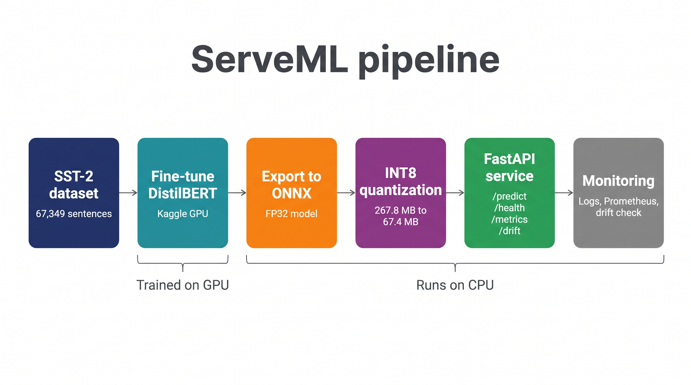

# ServeML

Fine-tune a small text model, shrink it with INT8 quantization, serve it with FastAPI and watch it for data drift.

The task is sentiment analysis (positive or negative) on English movie text. The model is not the point. The point is the path to production: how much smaller and faster does the model get, how much accuracy does it lose, and how do you notice when live data stops looking like the training data.



## Results

Final model: DistilBERT fine-tuned on the full SST-2 training set (67,349 sentences) on a free Kaggle GPU. Everything else was measured on my own CPU (batch size 1, 200 requests after a warm-up, a laptop with other programs running).

CPU: Intel Core i5-8250U @ 1.60GHz (4 cores).

| Variant | Accuracy % | Size MB | p50 ms | p95 ms |
|---|---|---|---|---|
| PyTorch FP32 | 90.71 | 267.8 | 57.9 | 93.5 |
| ONNX FP32 | 90.71 | 267.9 | 26.5 | 42.4 |
| ONNX INT8 | 90.83 | 67.4 | 19.2 | 32.0 |

- Accuracy is measured on the 872 SST-2 validation sentences. The 95% margin of error is about 2 points, so INT8 shows no measurable accuracy change.
- INT8 is about 4 times smaller than FP32 and about 1.4 times faster than ONNX FP32.
- Latency varies between runs on my laptop (the PyTorch p50 was 46 ms in another run), so the ratios matter more than the absolute milliseconds.

## Two training runs

The same pipeline ran twice to see what the amount of training data changes. Model, epochs (2), learning rate (5e-5), batch size (16), seed (42), quantization and benchmark are the same. The differences are the data size and the hardware: run A used 8,000 sentences on my CPU, run B used all 67,349 sentences on a Kaggle GPU with fp16.

| Training data | PyTorch FP32 acc % | ONNX INT8 acc % | INT8 change (points) | INT8 size MB |
|---|---|---|---|---|
| 8000 sentences (CPU) | 88.76 | 87.96 | -0.80 | 67.4 |
| 67,349 sentences (Kaggle GPU) | 90.71 | 90.83 | +0.12 | 67.4 |

More data raised accuracy by about 2 points, which is about the size of the margin of error (2.1 points on 872 sentences). The INT8 change is within the noise in both runs. Latency is not compared across runs because it does not depend on the training data and it changes with the load of the machine. The files of the first run are in `results_cpu_subset/`.

Kaggle printed 91.06% for run B because it evaluates in fp16. The table uses the FP32 benchmark measured on my machine, which is the model that is served.

## How it works

```
SST-2 --> fine-tune DistilBERT --> ONNX export --> INT8 quantization --> FastAPI service
                                                                              |
                                                       request log, Prometheus metrics, drift check
```

| Step | Tool | Why |
|------|------|-----|
| Fine-tune | PyTorch, Transformers | gives the model its accuracy |
| Export | ONNX, Optimum | runs without PyTorch |
| Quantize | ONNX Runtime dynamic INT8 | smaller file, faster on CPU |
| Serve | FastAPI | usable by other programs, validates input |
| Monitor | Prometheus client, SciPy | catches silent failure |

## Quick start

Tested with Python 3.13. The versions in `requirements.txt` are pinned.

```bash
python -m venv .venv
source .venv/bin/activate        # Windows PowerShell: .venv\Scripts\Activate.ps1
pip install -r requirements.txt
```

Train the model. Option A, on your own CPU (8000-sentence subset, about 30 minutes):

```bash
python scripts/train.py
```

Option B, on a free Kaggle GPU with all 67,349 sentences (about 8 minutes): train with the same settings, download the model folder and place it so that `models/fp32/config.json` exists.

Then export, quantize, benchmark and test:

```bash
optimum-cli export onnx --model models/fp32 --task text-classification models/onnx
python scripts/quantize.py          # INT8
python scripts/benchmark.py         # accuracy, size, latency table
python scripts/build_reference.py   # reference data for the drift check
python -m pytest -q                 # 9 tests
uvicorn app.main:app                # http://127.0.0.1:8000/docs
```

To compare two training runs, keep the first run's `results/` folder as `results_cpu_subset/` and run:

```bash
python scripts/compare_runs.py results_cpu_subset results
```

## API

```bash
curl -X POST http://127.0.0.1:8000/predict \
  -H "Content-Type: application/json" \
  -d '{"text": "Terrible, it broke after two days"}'
```

Response:

```json
{"label": "negative", "confidence": 0.9971, "latency_ms": 15.3}
```

| Endpoint | Purpose |
|----------|---------|
| `POST /predict` | sentiment of one text (1 to 2000 characters, empty text is rejected) |
| `GET /health` | service check |
| `GET /metrics` | Prometheus metrics (request count by label, latency histogram) |
| `GET /drift` | drift report against the validation set |
| `POST /drift/reset` | clear the in-memory window |

The model reads at most 128 tokens, so longer text is truncated.

## Monitoring and drift

Every prediction is written to `logs/predictions.jsonl` (text length, label, confidence, latency). `GET /drift` compares the last 1000 requests with a reference built from the validation set:

- input length and confidence: two-sample Kolmogorov-Smirnov test
- label share: chi-square test

A p-value below 0.01 counts as drift. At least 100 requests are needed first.

`python scripts/simulate_drift.py` sends 150 short SST-2 sentences first (status `ok`), then 150 long IMDB reviews (status `drift`). Output of my run:

```
normal traffic: ok
after shift: drift
{'status': 'drift', 'samples': 300, 'checks': {'input_length': {'p_value': 3.118014305172805e-51, 'drift': True}, 'confidence': {'p_value': 0.0017181472837144618, 'drift': True}, 'label_share': {'p_value': 0.2556494593967947, 'drift': False}}}
```

The input length and confidence checks detect the shift. The label share does not change much, which is expected because the reviews are still a mix of positive and negative. This is a simulation, not real traffic.

## Configuration

Defaults work out of the box. These environment variables change them.

| Variable | Used by | Default |
|----------|---------|---------|
| `MODEL_DIR`, `MODEL_FILE` | API | `models/onnx_int8`, `model_quantized.onnx` |
| `SERVEML_LOG`, `SERVEML_REFERENCE` | API | `logs/predictions.jsonl`, `results/reference.json` |
| `TRAIN_SIZE`, `EPOCHS`, `BASE_MODEL` | `train.py` | 8000, 2, `distilbert-base-uncased` |
| `FP32_DIR`, `ONNX_DIR`, `INT8_DIR`, `N_LATENCY` | `benchmark.py` | `models/fp32`, `models/onnx`, `models/onnx_int8`, 200 |

## Docker

Dockerfile included (not tested yet). The image copies `models/onnx_int8`, so run the quick start first.

```bash
docker build -t serveml .
docker run -p 8000:8000 serveml
```

## Limits

- Trained on short English movie sentences. Other domains will perform worse, which the drift demo shows.
- Dynamic INT8 only. Static quantization with calibration data and FP16 were not tried.
- One model and one dataset, with no hyperparameter search.
- The validation set has only 872 sentences, so small differences are noise. No paired significance test was run.
- Latency was measured on one laptop with other programs running. It is not a load test.
- The drift check is statistical. It says the data changed, not that the model is wrong. The three tests are not corrected for multiple testing.
- The drift window is kept in memory and resets when the service restarts.
- The model gives a label and a confidence for any text, so a high confidence does not mean a correct answer.

## Project structure

```
app/                FastAPI service and monitoring
scripts/            train, quantize, benchmark, compare runs, reference, drift simulation
tests/              API tests
results/            benchmark, comparison and reference files of the final run
results_cpu_subset/ files of the first run (8000 sentences, CPU)
docs/images/        diagrams and screenshots
models/             generated, not committed
logs/               generated, not committed
```